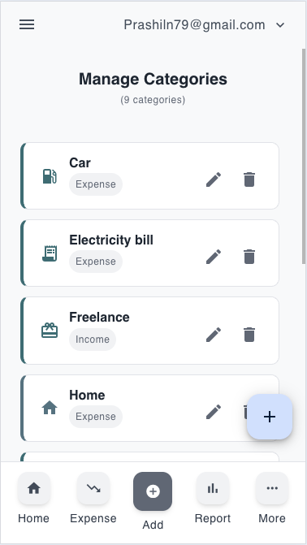
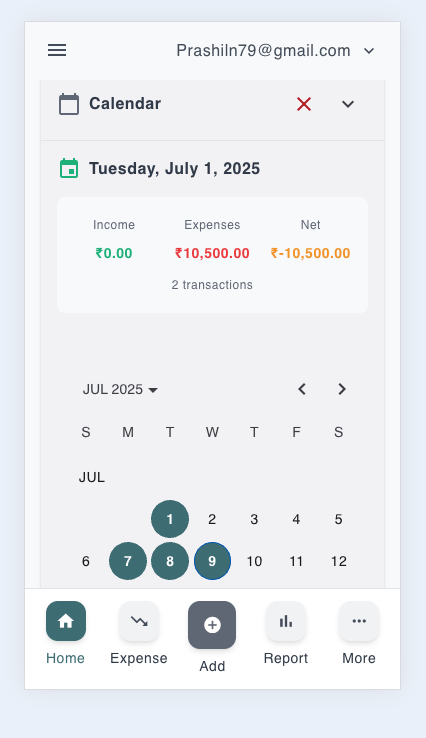
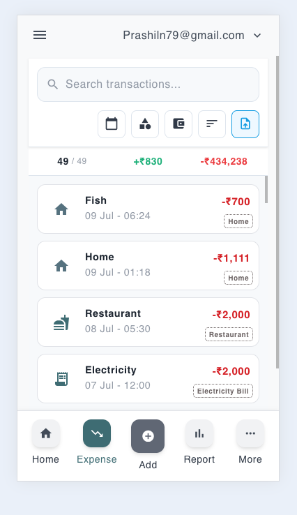

<p align="center">
  
</p>

<p align="center">
  <a href="https://prashiln79.github.io/money-manager" target="_blank"
     style="background:#4f46e5; color:white; padding:12px 22px; border-radius:8px; text-decoration:none; font-weight:600; display:inline-block; margin: 4px;">
     🚀 Go to Web App
  </a>
  &nbsp;&nbsp;
  <a href="https://play.google.com/store/apps/details?id=io.github.prashiln79.twa" target="_blank"
     style="background:#059669; color:white; padding:12px 22px; border-radius:8px; text-decoration:none; font-weight:600; display:inline-block; margin: 4px;">
     📱 Get on Google Play
  </a>
</p>

<p align="center">
  <a href="https://play.google.com/store/apps/details?id=io.github.prashiln79.twa" target="_blank">
    
  </a>
  
  
  
  
</p>

# Family Expense Tracker

**Family Expense Tracker** is a production-grade personal and household finance application designed to help individuals and families track, analyze, and optimize their financial life. Built with modern web technologies and a focus on privacy and user experience, it offers a seamless cross-platform experience with offline PWA support, advanced AI-powered transaction parsing, multi-currency tracking, and automated SEO prerendering for search visibility.

## 🌟 Key Features

### 🤖 AI Financial Assistant
- **Natural Language Processing**: Simply type or speak (e.g., "Spent 500 on groceries") to record transactions automatically.
- **Voice Commands**: Integrated microphone support for hands-free entry using OpenAI Whisper.
- **Smart Insights**: Ask conversational queries like "How much did our family spend on food last month?" for instant summaries.

### 💰 Comprehensive Financial & Family Budgeting Tools
- **Multi-Account & Wallet Tracking**: Manage cash, bank accounts, credit cards, and family budgets in a unified dashboard.
- **Smart Budget Alerts**: Establish monthly category thresholds and receive real-time visual progress warnings.
- **Custom Categories & Subcategories**: Organize income and expenses tailored to household needs.
- **Multi-Currency & Internationalization (i18n)**: Seamless language localization powered by `@ngx-translate`.

### 📊 Analytics & Data Visualization
- **Interactive Visual Reports**: Visualize spending habits with rich charts powered by ECharts and AmCharts.
- **Cash Flow Trends**: Track income vs. expense balance, category breakdowns, and long-term trends.
- **Export & Backup**: Export transaction histories for accounting and record-keeping.

### 🛠 Technical Excellence & Modern SEO
- **Offline-First PWA**: Installable Progressive Web App with service worker caching and background sync.
- **Android TWA (Trusted Web Activity)**: Distributed on the Google Play Store.
- **Static SEO Prerendering**: Pre-generated static landing, privacy, terms, feedback, and data-deletion pages for 100% crawlability by Google and search engines on GitHub Pages.
- **Dynamic SEO Metadata**: Real-time Open Graph, Twitter Cards, canonical links, and Schema.org JSON-LD structured data (`SoftwareApplication` & `WebSite`).
- **Responsive Design**: Designed for mobile, tablet, and desktop viewports with dark and light theme support.

## 🏗 Tech Stack

| Category | Technologies |
|----------|--------------|
| **Frontend Framework** | Angular 21, TypeScript |
| **State Management** | NgRx 21 (Store, Effects, Entity, DevTools) |
| **UI & Styling** | Angular Material, Tailwind CSS, SCSS |
| **Backend & Cloud** | Firebase (Cloud Firestore, Authentication, Analytics, Cloud Messaging) |
| **AI Integration** | OpenAI GPT-4o API, OpenAI Whisper |
| **Charts & Visuals** | Apache ECharts, AmCharts |
| **Testing** | Jasmine, Karma, Playwright (E2E) |
| **Deployment & SEO** | GitHub Pages, Automated Static Prerendering, PWA Service Worker |

## 📐 Architecture

The application follows a scalable modular architecture emphasizing strict separation of concerns:

- **Facade Pattern**: Abstraction layer between UI components and NgRx state management, keeping components focused purely on presentation.
- **Feature Modules**: Lazy-loaded feature routes (`Dashboard`, `Transactions`, `Analytics`, `Settings`, `Auth`) for optimal bundle sizes and quick initial loads.
- **Smart & Presentational Components**:
    - **Smart Components**: Manage state subscriptions and business actions via Facade services.
    - **Presentational Components**: Receive inputs and emit output events without direct state coupling.
- **Static SEO Builder**: Post-build script (`scripts/generate-static-seo-pages.js`) builds clean static directory structures for public routes (`/landing`, `/privacy-policy`, etc.) and a SPA `404.html` redirection engine for GitHub Pages.

## 🚀 Getting Started

### Prerequisites

- Node.js (v18 or higher)
- npm (v9 or higher)
- Angular CLI (`npm install -g @angular/cli`)

### Installation

1. **Clone the repository**
   ```bash
   git clone https://github.com/prashiln79/money-manager.git
   cd money-manager
   ```

2. **Install dependencies**
   ```bash
   npm install
   ```

3. **Environment Setup**
   - Run configuration script to populate environment variables:
     ```bash
     npm run config
     ```
   - Configure your Firebase credentials and OpenAI API keys in `src/environments/environment.ts`.

4. **Start the development server**
   ```bash
   npm start
   # Application opens at http://localhost:4200
   ```

## 🏗 Building & Deployment

```bash
# Build production bundle and automatically run postbuild static SEO generation
npm run build

# Run build with cache busting
npm run build:cache-bust

# Run full deployment preparation
npm run deploy
```

The build output is generated in `dist/money-manager/` ready for GitHub Pages hosting.

## ✅ Testing

```bash
# Run unit tests
npm test

# Run unit tests in headless mode with code coverage
npm run test:ci

# Run Playwright End-to-End (E2E) tests
npm run test:e2e

# Run Playwright E2E interactive UI mode
npm run test:e2e:ui
```

## 📂 Project Structure

```
src/
├── app/
│   ├── component/             # Feature components (Dashboard, Landing, Settings, etc.)
│   ├── layouts/               # Responsive Desktop & Mobile layout containers
│   ├── modules/               # Lazy-loaded feature modules
│   ├── pages/                 # Route page components
│   ├── store/                 # NgRx State (Actions, Reducers, Selectors, Effects)
│   ├── util/                  # Services (SEO, AI Chat, Auth, Notifications, Guards)
│   └── app-routing.module.ts  # Route definitions with SEO metadata & guards
├── assets/                    # Images, icons, screenshots, and i18n translation JSONs
├── environments/              # Environment configurations
├── index.html                 # Main SPA template with Schema.org JSON-LD
├── robots.txt                 # Search engine crawler policies
└── sitemap.xml                # Sitemap with clean canonical URLs
scripts/
├── generate-static-seo-pages.js # Prerenders static HTML pages & 404 SPA fallback
├── set-env.js                 # Injects environment variables at build time
└── sync-i18n.js               # Synchronizes internationalization translation keys
```

## 📸 Screenshots

<table width="100%">
  <thead>
    <tr>
      <th align="center" width="33%">📊 Dashboard Overview</th>
      <th align="center" width="33%">💰 Budget & Categories</th>
      <th align="center" width="33%">📈 Reports & Analytics</th>
    </tr>
  </thead>
  <tbody>
    <tr>
      <td align="center">
        
      </td>
      <td align="center">
        
      </td>
      <td align="center">
        
      </td>
    </tr>
  </tbody>
</table>

## 🤝 Contributing

1. Fork the repository
2. Create your feature branch (`git checkout -b feature/amazing-feature`)
3. Commit your changes (`git commit -m 'Add some amazing feature'`)
4. Push to the branch (`git push origin feature/amazing-feature`)
5. Open a Pull Request

## 📄 License

This project is licensed under the MIT License.

